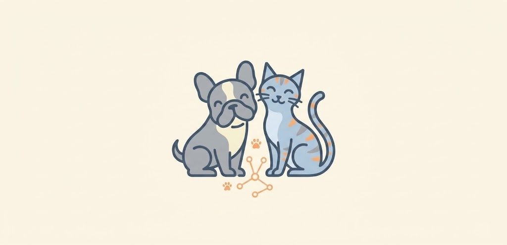
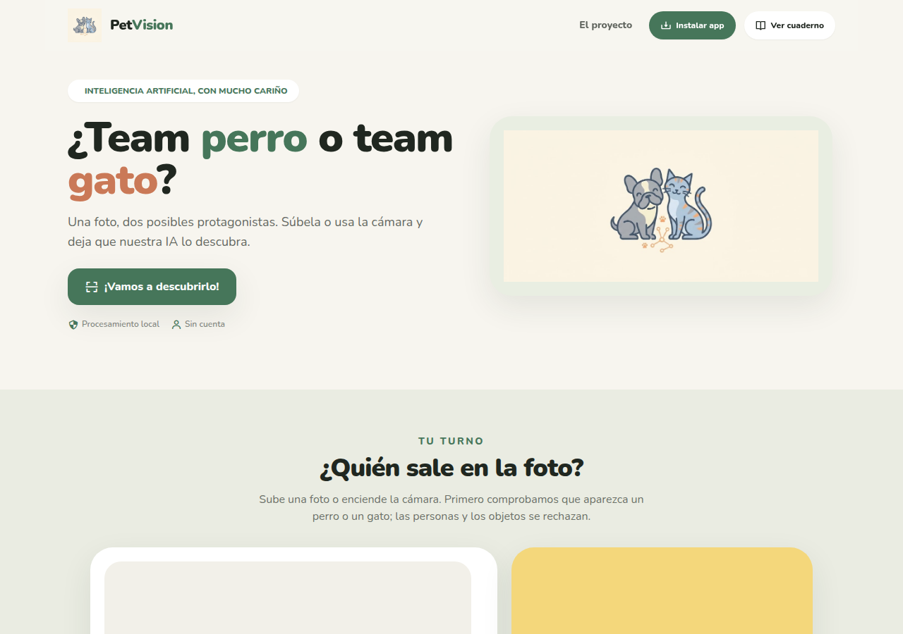
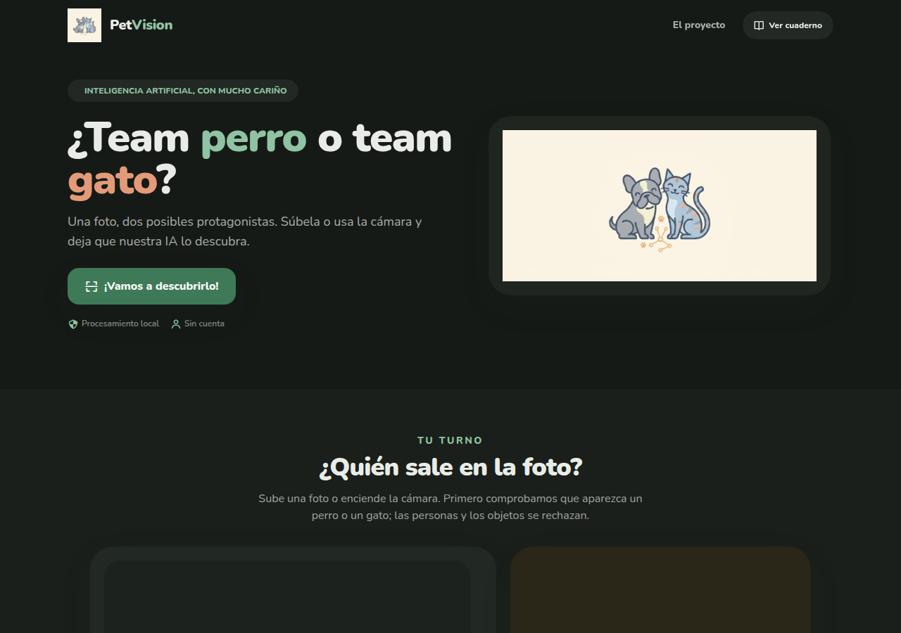
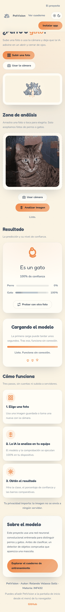
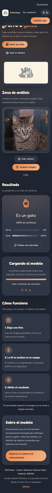
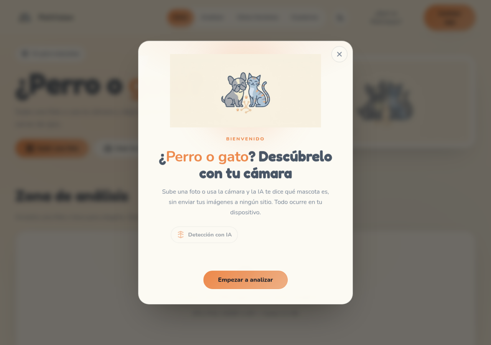
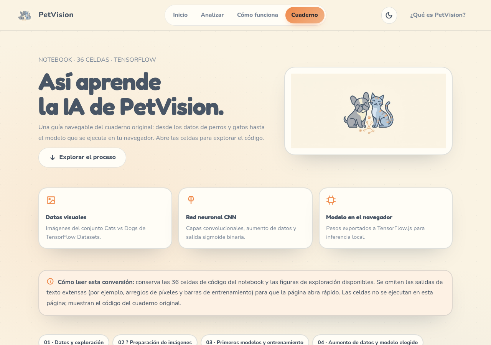
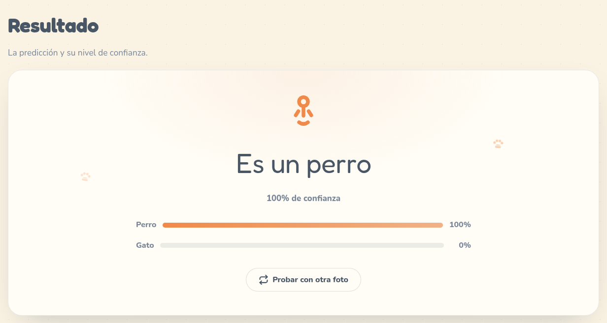
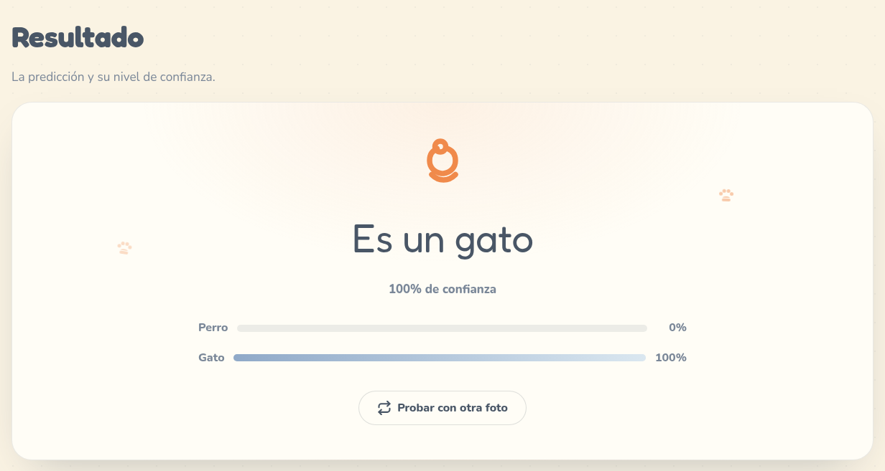
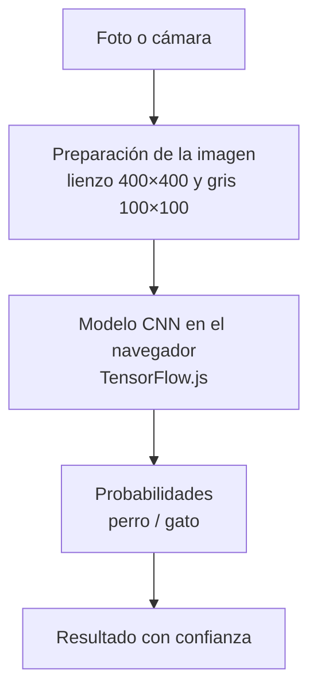

<p align="center">
  
</p>

<h1 align="center">PetVision</h1>

<p align="center"><strong>¿Perro o gato? Una IA que lo descubre en tu navegador</strong></p>

<p align="center">
  
  
  
  
  
  
</p>

<p align="center">
  <a href="https://rolandovs7.github.io/PetVision/">
    
  </a>
</p>

Le enseñas una foto a PetVision y te dice si el animal es un perro o un gato, con un porcentaje de confianza. Todo pasa dentro de tu navegador: no hay servidor que reciba la imagen ni registro que la guarde por ahí. Es una app sencilla, pensada para apoyar una decisión y no para reemplazar tu criterio.

---

## Pruébalo

Ábrela aquí mismo: **[rolandovs7.github.io/PetVision](https://rolandovs7.github.io/PetVision/)**

### Instálala como app (PWA)

PetVision se puede quedar en tu teléfono o escritorio. Después de la primera visita, funciona incluso sin conexión.

- **Android / Chrome / Edge:** abre la página y elige «Instalar app» o «Añadir a pantalla de inicio» en el menú del navegador. Si el botón **Instalar app** aparece en la cabecera, tócalo directamente.
- **iOS / Safari:** toca el botón de compartir y elige «Añadir a la pantalla de inicio».
- **Escritorio:** busca el icono de instalar en la barra de direcciones.

### En tres pasos

1. **Elige una foto o usa la cámara.** Arrastra una imagen, tócala desde tu galería o enciende la cámara.
2. **Espera el análisis.** La IA comprueba que haya una mascota y luego clasifica.
3. **Lee el resultado.** Verás la clase, la confianza y las barras de probabilidad de perro y de gato.

---

## Galería

La misma interfaz en los dos temas:

| Tema claro | Tema oscuro |
| :---: | :---: |
|  |  |
|  |  |

Otras vistas de la aplicación:

| | |
| :---: | :---: |
|  |  |
|  |  |

---

## ¿Cómo piensa PetVision?

El recorrido de una foto, de principio a fin:



Antes de clasificar, un detector de objetos (COCO-SSD) mira la escena: si no ve un perro ni un gato, la app lo dice y no inventa una respuesta. Si ve una persona y ninguna mascota, también avisa.

---

## El modelo

El clasificador que corre en la página se llama `petvision_classifier`. Es una **red neuronal convolucional** entrenada en el cuaderno `entrenamiento/Clasificador_de_perros_y_gatos.ipynb` y exportada a TensorFlow.js.

### Arquitectura

Así lo describe `web/modelo/model.json`:

| Capa | Qué hace |
|---|---|
| Entrada `100 × 100 × 1` | Recibe la foto en gris, normalizada entre 0 y 1 |
| Convolución, 32 filtros 3×3, ReLU | Busca bordes y texturas simples |
| MaxPool 2×2 | Reduce el tamaño y se queda con lo más marcado |
| Convolución, 64 filtros 3×3, ReLU | Combina esas marcas en formas |
| MaxPool 2×2 | Vuelve a comprimir |
| Convolución, 128 filtros 3×3, ReLU | Arma rasgos más propios del animal |
| MaxPool 2×2 | Última reducción espacial |
| Aplanar | Convierte el mapa en un vector |
| Densa, 100 neuronas, ReLU | Relaciona esos rasgos |
| Densa, 1 neurona, sigmoide | Entrega la probabilidad perro/gato |

La salida es un único número entre 0 y 1: cerca de **0** apunta a **gato** y cerca de **1** apunta a **perro**. En la página, si el valor es 0,5 o menor se muestra **Gato**; si es mayor, **Perro**. La confianza es la probabilidad de la clase elegida.

Los pesos viven en `web/modelo/group1-shard1of2.bin` y `web/modelo/group1-shard2of2.bin`, junto a `model.json`.

### Datos y entrenamiento

| Dato | Valor |
|---|---|
| Conjunto | `cats_vs_dogs` de TensorFlow Datasets (fotos de Microsoft / Kaggle) |
| Imágenes | 23 262 |
| Entrada | 100 × 100 píxeles, un canal en escala de grises |
| Entrenamiento | 19 700 imágenes |
| Validación | 3 562 imágenes |
| Aumento de datos | Giro 30°, desplazamiento 0.2, cizalla 15°, zoom 0.7–1.4, volteo horizontal y vertical |

En el cuaderno se compararon tres ideas: una red densa, esta red convolucional y una convolucional con dropout. La que se publicó es la convolucional **con aumento de datos** (`modeloCNN_AD`).

- Optimizador **Adam**, pérdida de **entropía cruzada binaria** y métrica de **exactitud**.
- Lotes de **32** imágenes y **150 épocas** sobre las imágenes aumentadas.
- Se guardó como `perros-gatos-cnn-ad.h5` y se convirtió con `tensorflowjs_converter`.

El cuaderno navegable está dentro de la propia app: [`web/cuaderno/Clasificador_de_perros_y_gatos.html`](web/cuaderno/Clasificador_de_perros_y_gatos.html).

### Qué ocurre al pulsar «Analizar»

1. **Filtro.** COCO-SSD con MobileNet v2 revisa la imagen. Solo sigue adelante si detecta `dog` o `cat` con una puntuación de al menos 0,25. Si ve una persona (puntuación ≥ 0,40) y ninguna mascota, la foto se rechaza.
2. **Clasificador propio.** La imagen se reduce a 100×100, se pasa a gris (pesos `0,114` azul, `0,587` verde, `0,299` rojo) y se divide entre 255. `predict` devuelve la sigmoide y de ahí salen las probabilidades.

---

## Funciones

- **Sube una foto o usa la cámara.** Acepta JPG, PNG, WEBP o GIF hasta 12 MB; también puedes arrastrar la imagen.
- **Filtro de mascota.** Antes de clasificar, comprueba que la foto tenga un perro o un gato y descarta personas u objetos.
- **Clasificación local.** La red corre en tu equipo con TensorFlow.js y muestra las barras de probabilidad.
- **Nivel de confianza.** Si el resultado es flojo (por debajo del 60 %), te lo advierte en lugar de venderte una certeza.
- **Tema claro y oscuro.** Hay un interruptor en la cabecera y, si no eliges, se respeta el ajuste de tu sistema. Tu elección se recuerda en el dispositivo.
- **Instalable y sin conexión.** Se añade como PWA y, tras la primera carga, sigue funcionando offline.
- **Diseño adaptable.** Pensada para móvil, tableta y escritorio, con menú propio en pantallas pequeñas.

## Privacidad

Las imágenes **no salen de tu dispositivo**. El análisis ocurre por completo en el navegador, así que no hay subidas ni cuentas. Las preferencias (tema y si ya viste la bienvenida) se guardan en el almacenamiento local del navegador.

## Uso sin conexión

La primera visita guarda la aplicación, el modelo y las librerías mediante un *service worker*. A partir de ahí puedes abrir PetVision sin internet y clasificar con normalidad. Si limpias los datos del sitio, la próxima vez necesitarás conexión para volver a llenar la caché.

## Límites conocidos

- Una foto oscura, borrosa o con **varios animales** puede fallar.
- El filtro previo también se equivoca: a veces deja pasar algo que no es mascota o frena una foto válida.
- Solo distingue **perros y gatos**; otras especies quedan fuera.
- La confianza es una **estimación**, no una certeza.
- El proyecto es **educativo**: apoya una clasificación sencilla, no sirve para un diagnóstico ni para identificar a una mascota concreta.

## Mejoras futuras

- Mostrar un historial visible de las últimas clasificaciones.
- Ajustar el umbral de confianza según el dispositivo.
- Añadir más especies o razas.
- Mejorar el manejo de fotos con varias mascotas.

---

## Cómo ejecutarlo en local

### Con Python (sin instalar nada más)

Desde la carpeta del proyecto:

```bash
python3 -m http.server 8800 --directory web
```

Abre [http://localhost:8800](http://localhost:8800). No abras `index.html` con doble clic: la cámara, el modelo y el service worker necesitan una dirección `http://`, no `file://`.

### Con Docker

Con [Docker](https://docs.docker.com/get-docker/) instalado:

```bash
docker compose up --build
```

Abre [http://localhost:8080](http://localhost:8080). Para detenerlo: `docker compose down`.

Docker solo usa Nginx para servir la carpeta `web/`; no instala Node ni entrena nada. Nginx publica en el puerto 8080, comprime texto y JSON, cachea los pesos `.bin` durante un año y entrega el service worker y el manifest sin caché para que una actualización se note al recargar.

---

## Estructura del proyecto

```text
PetVision/
├── README.md                 Esta guía
├── LICENSE                   Licencia Apache 2.0
├── compose.yaml              Arranque con Docker
├── .gitignore                Archivos ignorados por Git
├── .dockerignore             Archivos que no entran en la imagen
├── docker/                   Configuración del contenedor
│   ├── Dockerfile            Imagen nginx:1.27-alpine que sirve web/
│   └── nginx.conf            Puerto 8080, compresión y cabeceras de caché
├── docs/                     Documentación
│   └── capturas/             Capturas de la interfaz
├── entrenamiento/            Entrenamiento del modelo
│   └── Clasificador_de_perros_y_gatos.ipynb   Cuaderno de entrenamiento
└── web/                      Lo que ve el navegador
    ├── index.html            Estructura de la página
    ├── styles.css            Estilos y variables de tema
    ├── site.js               Tema, menú, bienvenida y service worker
    ├── app.js                Cámara, carga de foto y clasificación
    ├── service-worker.js     Caché para el uso sin conexión
    ├── manifest.webmanifest  Metadatos de la PWA
    ├── assets/               Logotipo, iconos, favicons e imagen para redes
    ├── modelo/               Topología y pesos del clasificador
    │   ├── model.json
    │   ├── group1-shard1of2.bin
    │   └── group1-shard2of2.bin
    └── cuaderno/             Cuaderno navegable del entrenamiento
        └── Clasificador_de_perros_y_gatos.html
```

---

## Autoría y licencia

**Autor: Rolando Velasco Soliz · Materia: INF432**

Este proyecto se distribuye bajo la [Licencia Apache 2.0](LICENSE). Copyright 2026 Rolando Velasco Soliz.
